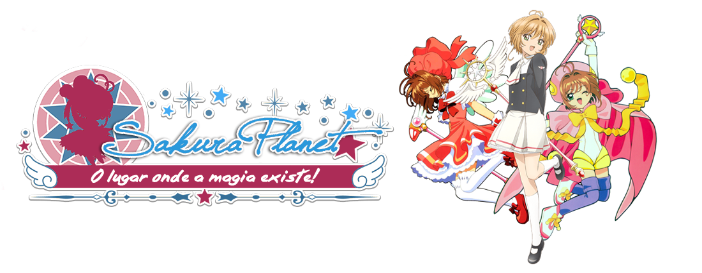

<p align="center">
  
</p>

# Sakura Planet — Tema para Blogger

Tema personalizado em XML para o blog **[Sakura Planet](https://sakuraplanetscc.blogspot.com/)**, fansite brasileiro de *Card Captor Sakura* no ar desde 17/03/2011. A identidade visual usa **rosa, azul e branco**, com a logo recolorida para combinar com a paleta.

> Projeto de fãs, sem fins lucrativos e sem vínculo com os detentores dos direitos de *Card Captor Sakura*.

## Sumário
- [Sobre o modelo](#sobre-o-modelo)
- [Onde é usado](#onde-é-usado)
- [Recursos](#recursos)
- [Estrutura do repositório](#estrutura-do-repositório)
- [Instalação](#instalação)
- [Configuração](#configuração)
- [Guideline visual](#guideline-visual)
- [Limitações conhecidas](#limitações-conhecidas)
- [Créditos](#créditos)
- [Direitos autorais](#direitos-autorais)

## Sobre o modelo
É um tema do Blogger (formato clássico, com widgets) derivado do modelo **Travel**. Foi revisado em novembro de 2026 para:

- padronizar a identidade visual (cores, fontes e componentes) em torno de variáveis CSS;
- corrigir erros de CSS e de HTML e remover dependências inseguras ou que não funcionam mais;
- adicionar uma **paginação numerada** própria, no estilo do site.

O layout é de duas colunas (posts e sidebar à direita), com cabeçalho em banner, menu horizontal em pílulas e rodapé de créditos.

## Onde é usado
- Blog principal: <https://sakuraplanetscc.blogspot.com/>
- Páginas fixas do menu: História, Anime, Mangás, Música, Fan Area, Galeria, Sobre Nós e Contato.
- Sidebar: Bem-vindos, Informações, Marcadores, Arquivo, Busca, Seguidores, Parceiros, Extras e Publicidade.

## Recursos
- **Paleta única** definida em `:root` (`--sp-*`), fácil de alterar.
- **Menu em pílulas** rosa, com hover azul. No celular (até 860 px) vira um **menu suspenso** com botão "☰ Menu".
- **Paginação numerada** (`‹ 1 … 3 [4] 5 … 12 ›`) para página inicial, marcadores e busca, com os links nativos do Blogger como alternativa se o script falhar.
- **Layout responsivo:** o celular usa o mesmo visual do site (menu, posts, sidebar, paginação, comentários e rodapé), com a sidebar abaixo dos posts.
- **Sidebar alinhada aos posts:** mesmo topo, mesmo espaçamento (`--sp-gap`) e mesma largura de cartão.
- **Botão de voltar ao topo** sem jQuery.
- Comentários, citações, rodapé e sidebar recoloridos na mesma paleta.
- Fontes decorativas (Sofia, Playball, Cookie) numa única chamada, com `display=swap`.
- Links próprios e imagens em `https`.

## Estrutura do repositório
```
.
├── README.md
├── CHANGELOG.md
├── theme/
│   └── sakura-planet-theme.xml     # tema para importar no Blogger
├── assets/
│   └── logo-sakura-planet.png      # logo/banner recolorido (1100×430, transparente)
└── docs/
    └── guia-visual.html            # guia visual (abra no navegador)
```

## Instalação
1. No Blogger, abra **Tema** e use **Backup/Restaurar › Fazer download** para guardar o tema atual.
2. Em **Backup/Restaurar › Fazer upload**, envie `theme/sakura-planet-theme.xml`.
3. Em **Layout › Cabeçalho › Editar**, envie `assets/logo-sakura-planet.png` e salve. O tema desenha a logo como imagem responsiva, então ela se ajusta sozinha ao tamanho da tela.
4. Confira a configuração abaixo e teste o blog.

Antes de publicar, abra a página inicial, um marcador, a busca e um post, no computador e no celular, e teste uma página numerada.

## Configuração
- **Celular:** o tema já é responsivo. Para garantir que o Blogger não use o modelo simplificado, abra **Tema › ⚙ ao lado de "Personalizar" › Tema para dispositivos móveis** e escolha **"Não. Mostrar o modelo para computador em dispositivos móveis"**. Há também um script de reserva no `<head>` que troca `?m=1` por `?m=0`.
- **Postagens por página:** em `Configurações › Postagens`, o campo "Número de postagens na página principal" deve ser igual ao valor `perPage` do script do `page-navi` (padrão: `5`). Se forem diferentes, a contagem de páginas fica errada.
- **Menu:** edite o gadget HTML do topo. Cada item segue o padrão `<div class="menuattitude"><a href="...">Nome</a></div>`. O botão do menu suspenso é criado por script, então não precisa de marcação extra; mantenha todos os itens juntos no mesmo gadget.
- **AdSense:** o ID do editor está no cabeçalho do XML e no gadget "Publicidade". Troque pelo seu se reutilizar o tema.

## Guideline visual
O guia completo, com exemplos, está em [`docs/guia-visual.html`](docs/guia-visual.html). Resumo:

| Token | Cor | Uso |
|---|---|---|
| `--sp-rosa-400` | `#faa7b9` | Cor da marca: menu, títulos da sidebar, bordas |
| `--sp-rosa-600` | `#dc6f93` | Links visitados |
| `--sp-rosa-700` | `#b8446b` | Item ativo da paginação, datas, comentários |
| `--sp-azul-500` | `#459dc7` | Cor da marca: títulos e bordas |
| `--sp-azul-700` | `#1175a4` | Links e botões |
| `--sp-azul-900` | `#436590` | Links do rodapé |
| `--sp-branco` | `#ffffff` | Cards e texto sobre cor escura |
| `--sp-texto` | `#444444` | Texto corrido |

Regras principais:
- **Nunca digitar hexadecimal solto** nas regras: use as variáveis.
- **Contraste:** texto branco só sobre Rosa 700, Azul 700 ou Azul 900. Sobre Rosa 400, use texto `#444`.
- **Logo:** sempre sobre fundo branco ou claro. Não recolorir, esticar nem cortar a ilustração das personagens.
- **Evitar:** verde, amarelo, roxo, magenta e bege; scripts em `http://`; jQuery antigo; hotlink de Imgur, Photobucket ou Dropbox; comentários CSS com `//`.

## Limitações conhecidas
- A paginação numerada usa o feed do Blogger. Quem entra por um link direto de uma página interna, sem o `#PageNo=` na URL, vê a página 1 destacada.
- Em páginas de post e de arquivo, o tema usa os links "mais recentes / mais antigas" do Blogger.
- O layout tem largura máxima de 1020 px e empilha as colunas abaixo de 860 px. Gadgets de terceiros com largura fixa (iframes, banners) são limitados a 100%, mas conteúdo antigo dentro dos posts pode precisar de ajuste.
- Com o modelo móvel do Blogger desativado, recursos exclusivos dele (como a capa em lista) deixam de existir.

## Créditos
- **Modelo base "Travel"**: Sookhee Lee — [plyfly.net](https://www.plyfly.net).
- **Estilo de comentários**: papogarota.com.br.
- **Personalização da data dos posts**: Garota do Olhar Sincero.
- **Design e criação do Sakura Planet**: Vitor Araújo ([@chaosdevacelli](https://twitter.com/chaosdevacelli)).
- **Padronização visual, correções e paginação numerada (2026)**: feitas com apoio do Claude, da Anthropic.
- **Banner e ilustração**: arte original do Sakura Planet, com as personagens de *Card Captor Sakura*.

## Direitos autorais
*Card Captor Sakura*, suas personagens e imagens pertencem a **CLAMP · Shigatsu Tsuitachi Co., Ltd. / Kodansha / NHK / NEP**. O Sakura Planet é um site de fãs e não oficial. A ilustração das personagens que aparece no banner **não** é coberta por nenhuma licença deste repositório.

O código do tema deriva do modelo Travel do Blogger, e os termos dele continuam valendo para a parte herdada. A licença das alterações próprias fica a critério do mantenedor, que pode adicionar um arquivo `LICENSE`.
